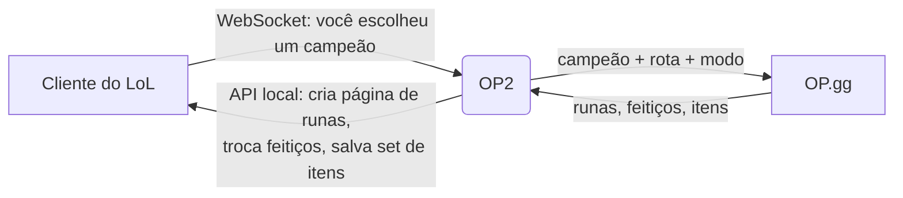

<div align="center">


# OP2

**Runas, feitiços e itens do OP.gg aplicados automaticamente no League of Legends.**<br>
Sem propaganda, sem janela, sem pesar o PC: só um ícone na bandeja.

[](https://github.com/fioravante-dev/op2/releases/latest)
[](https://github.com/fioravante-dev/op2/actions/workflows/release.yml)
[](https://github.com/fioravante-dev/op2/releases)


[](LICENSE)

### [⬇️ Baixar o OP2 (op2.exe)](https://github.com/fioravante-dev/op2/releases/latest/download/op2.exe)

</div>

---

## Por que o OP2 existe

Quem joga LoL quase sempre abre o OP.gg (ou Blitz, Porofessor...) só por um motivo:
**importar a build na seleção de campeão**. Esses apps resolvem isso, mas vêm junto com
anúncios, janelas, overlays, estatísticas que você não pediu, e geralmente rodam em
Electron ou Overwolf, que ocupam **centenas de MB de RAM** enquanto você joga.

O OP2 faz **só essa parte**, do jeito mais leve possível:

1. Você escolhe o campeão.
2. Em menos de 1 segundo, a página de runas, os feitiços e o set de itens já estão prontos.
3. Pronto. Ele volta a dormir.

Os dados das builds continuam vindo do OP.gg, então a qualidade das recomendações é a mesma.

## Desempenho

Medido no Windows 11, com o app aberto e o cliente do LoL conectado:

| | OP2 |
|---|---|
| Tamanho do programa | **1,7 MB** (um único `.exe`, sem instalar nada além dele) |
| Memória (RAM própria) | **~4–5 MB** |
| CPU parado esperando | **~0%** (0,8 s de CPU em 13 min, quase tudo na abertura) |
| Tempo para aplicar a build | **< 1 s** depois de escolher o campeão |
| Janelas, anúncios, overlay | nenhum |

Como consegue isso: é escrito em **Rust**, não abre navegador embutido, não fica
consultando nada em loop. O cliente do LoL **avisa** o OP2 (via WebSocket) quando
você escolhe um campeão; até lá ele só espera.

## Instalar

1. **[Baixe o `op2.exe`](https://github.com/fioravante-dev/op2/releases/latest/download/op2.exe)**.
2. Dê dois cliques. Ele se instala sozinho em `%LOCALAPPDATA%\Programs\OP2`,
   cria o atalho **OP2** na área de trabalho e já fica rodando na bandeja.
3. Abra o LoL e jogue. 🎮

> **"O Windows protegeu o computador"?** O `.exe` não tem assinatura digital paga,
> então o SmartScreen avisa na primeira vez. Clique em **Mais informações → Executar
> assim mesmo**. O código está todo aqui e o `.exe` é compilado pelo próprio GitHub
> ([veja o build](https://github.com/fioravante-dev/op2/actions/workflows/release.yml)).

**Atualizações são automáticas:** ao abrir, o OP2 procura uma versão nova nas
[Releases](https://github.com/fioravante-dev/op2/releases), baixa e reinicia sozinho.

## O que ele faz

- ✅ **Runas**: cria uma página "OP2 Campeão Rota" e deixa ativa. Apaga páginas que o OP.GG ou o Blitz deixaram
  (começam com "OP.GG" ou "Blitz"); suas páginas próprias não são tocadas
- ✅ **Feitiços**: aplica os mais usados, **mantendo o Flash na tecla que você já usa** (D ou F)
- ✅ **Itens**: set na loja com iniciais, botas, core e opções de 4º/5º/6º item, com a ordem de skills no título
- ✅ **Detecta rota e modo**: ranked solo/flex, normal, ARAM, ARAM: Caos, URF
- ✅ **Patch novo?** Limpa os sets de itens antigos automaticamente
- ✅ **Trocou de campeão?** Aplica a build do novo na hora

## Menu da bandeja

Clique com o botão direito no ícone **O** perto do relógio
(verde = conectado ao LoL, cinza = esperando o cliente abrir):

```
 OP2 v0.1.1
 Conectado ao LoL (patch 16.22)
 Última: Tristana ARAM winrate 52.0%
 ───────────────────────────────
 Reaplicar build agora
 Reaplicar como...          ▸  Top / Jungle / Mid / ADC / Suporte
 ───────────────────────────────
 ✔ Runas
 ✔ Feitiços
 ✔ Itens
 Flash                      ▸  Manter onde está / Sempre no D / Sempre no F
 ───────────────────────────────
 Verificar atualizações
 Abrir log
 Sair
```

- **Reaplicar build agora**: se algo não aplicou (internet caiu, cliente travou), força de novo.
- **Reaplicar como...**: em blind pick o cliente não informa a rota; escolha aqui qual quer.

## Como funciona



- **Cliente do LoL**: o launcher do LoL tem uma API local (a *LCU API*), a mesma que
  OP.gg, Blitz e Porofessor usam. O OP2 lê a porta e a senha do arquivo `lockfile`
  que o cliente cria ao abrir.
- **Builds**: vêm do [servidor MCP público do OP.gg](https://github.com/opgginc/opgg-mcp)
  (`mcp-api.op.gg`), que entrega as estatísticas já com os IDs que o cliente usa.

## Perguntas frequentes

**Dá ban?**
O OP2 só usa a API do **cliente** (o launcher), igual aos apps populares de build.
Ele **não lê nem mexe na memória do jogo**, não roda nada dentro da partida e não
dá nenhuma vantagem além de configurar o que você configuraria na mão. Dito isso, a
Riot não oferece garantia oficial para nenhum app que use essa API.

**Quais dados ele envia?**
Nenhum dado seu. Ele só conversa com:
- `127.0.0.1`: o próprio cliente do LoL, no seu PC;
- `mcp-api.op.gg`: pergunta "build do campeão X na rota Y, modo Z";
- `api.github.com`: verifica se tem versão nova.

Nada de conta, nick, partidas ou telemetria sai do seu PC.

**Onde ficam as configurações?**
Em `%APPDATA%\op2\config.json` (e o log em `%APPDATA%\op2\op2.log`).

**Arena funciona?**
Ainda não: o OP.gg não disponibiliza builds de Arena por essa API.

**Como desinstalar?**
Menu da bandeja → **Sair**. Depois apague a pasta `%LOCALAPPDATA%\Programs\OP2`,
o atalho da área de trabalho e, se quiser, `%APPDATA%\op2`.

## Desenvolvimento

Requer [Rust](https://rustup.rs) e Windows.

```powershell
cargo build                                    # debug (com console)
cargo test                                     # testes
.\target\debug\op2.exe teste Ahri mid          # aplica runas+itens agora, sem champ select
powershell -ExecutionPolicy Bypass -File install.ps1   # compila e instala a versão local
```

| Arquivo | O que faz |
|---|---|
| [`src/main.rs`](src/main.rs) | Bandeja, menu e instalação |
| [`src/watcher.rs`](src/watcher.rs) | Espera o cliente, escuta a seleção de campeão, detecta patch |
| [`src/lcu.rs`](src/lcu.rs) | Conexão com a API local do cliente (REST + WebSocket) |
| [`src/opgg.rs`](src/opgg.rs) | Busca as builds no OP.gg |
| [`src/apply.rs`](src/apply.rs) | Aplica runas, feitiços e sets de itens |
| [`src/update.rs`](src/update.rs) | Auto-instalação e atualização pelas Releases |
| [`build.rs`](build.rs) | Desenha o ícone e embute no `.exe` |

A pasta [`js/`](js/) tem o protótipo original em Node.js, mantido como referência.

### Publicar uma versão nova

1. Mude `version` no [`Cargo.toml`](Cargo.toml) (ex: `0.2.0`) e faça commit.
2. `git tag v0.2.0` e `git push origin main --tags`
3. O [GitHub Actions](.github/workflows/release.yml) roda os testes, compila e publica
   o `op2.exe`. Todos os OP2 instalados se atualizam na próxima vez que abrirem.

## Licença

[MIT](LICENSE): pode usar, modificar e distribuir à vontade, desde que mantenha o aviso de copyright.

---

<sub>OP2 não é afiliado, endossado ou patrocinado pela Riot Games nem pelo OP.GG.
League of Legends e Riot Games são marcas registradas da Riot Games, Inc.
OP.GG é marca registrada da OP.GG Inc.</sub>
